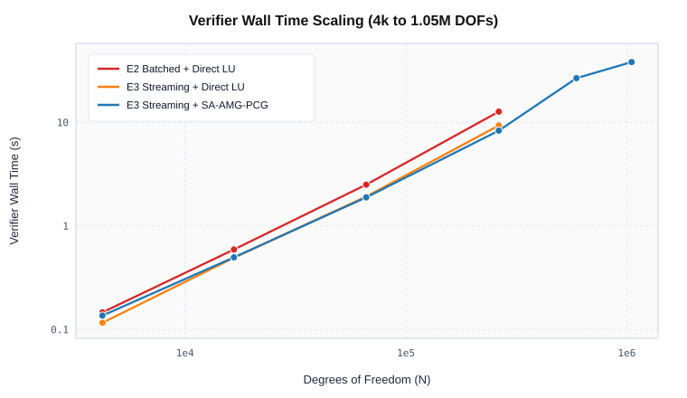
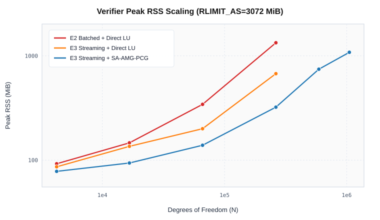
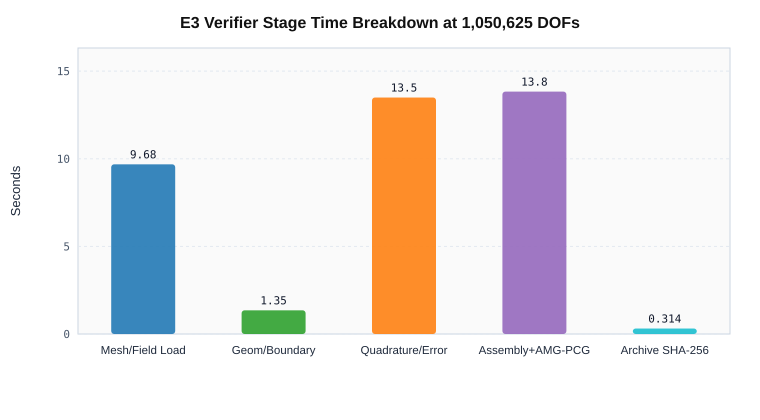
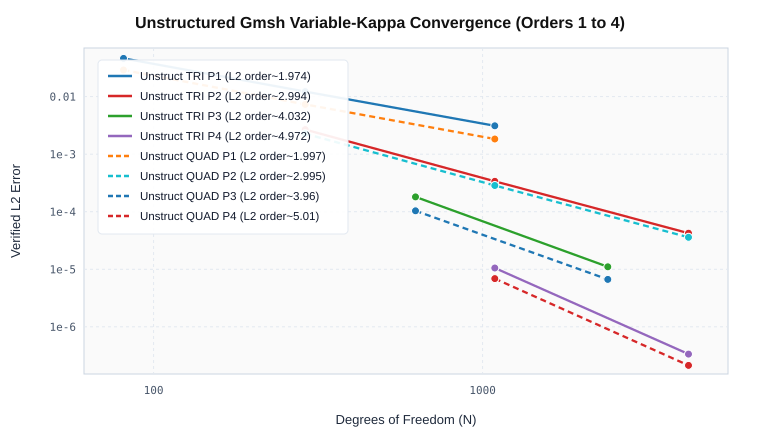
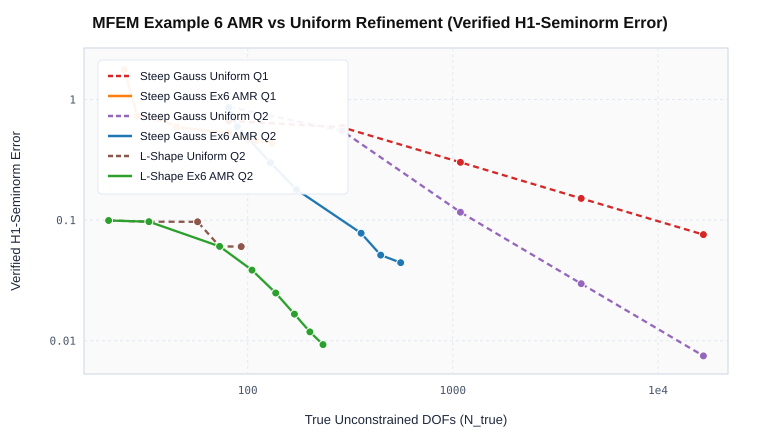
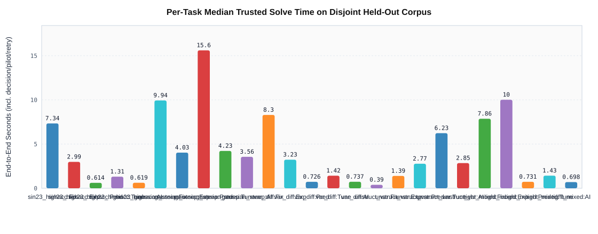

# E3: Deep Performance Optimization, Complex Meshes/AMR & Adaptive Decision Research

**Branch**: `research/e3-scaling-adaptive` (branched cleanly from E2 baseline `903bb0b` without modifying E2 `main` @ `ceb485c`)  
**MFEM Revision**: `v4.10.0` (`d964264cdb9a13e94a201b6c236c7721e0c8765f`, serial double-precision, unmodified upstream C++ library)  
**Test Environment**: WSL2 `Ubuntu-24.04`, 16 logical CPUs, 7.4 GiB RAM / 2.0 GiB Swap, GCC 13.3.0, CMake 3.28.3, Python 3.12 (`numpy 2.5.5`, `scipy 1.18.1`, `pydantic 2.14.4`, `pytest 9.2.0`)  
**Regression Gate**: `454 passed, 9 deselected (MPI), 0 failed, 0 skipped` (`python -m pytest -q -m "not mpi" --require-mfem`)

---

## 1. Task 1 — Verifier Scalability from 4k to 1.05M DOFs

### 1.1 Architecture Changes
- **Chunked I/O & Streaming Quadrature/Assembly** ([`verifier/fem.py`](../verifier/fem.py), [`verifier/verifier.py`](../verifier/verifier.py)):
  - `_loadtxt` and `_load_elements` stream raw ASCII artifacts in 65,536-row chunks instead of full-file materialization.
  - Elements above `E > 32,768` (or `reference_solve_method="amg_pcg"`) bypass monolithic `element_quadrature` arrays `(E, Q, ...)` via `evaluate_quadrature_slice`, `_streaming_errors`, and `_streaming_reference_solve` (65k-chunk CSR tree reduction + bounded periodic `Ke_shared` reuse).
- **Independent Residual-Verified SA-AMG-PCG** ([`verifier/reference_solver.py`](../verifier/reference_solver.py)):
  - Pure-NumPy/SciPy Smoothed-Aggregation Algebraic Multigrid (`_build_amg_hierarchy`: vectorized `int64` mutual heavy-edge double-pairwise aggregation, Chebyshev degree-2 polynomial smoother, sparse coarse LU) paired with PCG + iterative refinement.
  - Enforces **Oettli–Prager normwise backward stability** (`||K u - rhs||_2 / (|| |K| |u| ||_2 + ||rhs||_2) <= 1e-13`) and floating-point roundoff-aware relative residual (`<= min(1e-10, max(verify_residual_tol, 256 * eps * (|| |K| |u| ||_2 + ||rhs||_2) / ||rhs||_2))`), raising `ReferenceSolverError` fail-closed on singular or unconverged solves (`maxiter` too low, `info != 0`, or residual violation).
  - Canonical E2 spec hashes remain bit-identical via `exclude_if` on `ValidationSpec.reference_solve_method` / `reference_solve_amg_threshold_dofs` ([`sciagent/spec.py`](../sciagent/spec.py)).

### 1.2 Measured Scaling Results ([`evidence/e3/scaling_4k_to_1m.json`](../evidence/e3/scaling_4k_to_1m.json))
All runs executed in isolated `RLIMIT_AS = 3072 MiB` subprocesses on `poisson_mms --case sin_sin --mesh-type tri --order 1` ([`benchmarks/e3_scaling.py`](../benchmarks/e3_scaling.py)):

| Grid `n` | DOFs (`N`) | Elements (`E`) | Native `poisson_mms` (s / MiB) | E2 Batched+Direct (s / MiB) | E3 Streaming+Direct (s / MiB) | E3 Streaming+AMG (s / MiB) | AMG vs MFEM `rel_diff` |
|---:|---:|---:|---:|---:|---:|---:|---:|
| 64 | 4,225 | 8,192 | 0.1169 / 10.6 | 0.1463 / 92.3 | 0.1161 / 86.4 | 0.1363 / 78.1 | `2.37e-14` |
| 128 | 16,641 | 32,768 | 0.4263 / 17.8 | 0.5924 / 146.5 | 0.4942 / 135.6 | 0.4715 / 93.9 | `2.08e-14` |
| 256 | 66,049 | 131,072 | 1.6368 / 46.4 | 2.5105 / 342.6 | 1.9241 / 200.1 | 1.8916 / 138.9 | `2.69e-14` |
| 512 | 263,169 | 524,288 | 8.6070 / 160.6 | 12.7339 / 1,334.1 | 9.3552 / 674.8 | **8.3443 / 322.2** | `2.93e-14` |
| 768 | 591,361 | 1,179,648 | 21.7771 / 351.2 | *OOM (`ArrayMemoryError` 324 MiB)* | *OOM (`SUPERLU_MALLOC`)* | **26.6917 / 745.0** | `9.08e-12` |
| 1024 | **1,050,625** | 2,097,152 | 44.6244 / 617.2 | *OOM (`ArrayMemoryError` 576 MiB)* | *OOM (`MemoryError gssv`)* | **38.3608 / 1,081.4** | **`5.44e-14`** |

At `n=512` (263k DOFs), `e3_streaming_amg` cuts peak RSS by **4.14x** (`1,334.1 MiB -> 322.2 MiB`) and wall time by **1.53x**; at `n=1024` (**1,050,625 DOFs**), both direct baselines crash cleanly at the 3 GiB cap while `e3_streaming_amg` passes all independent checks in **38.36s** (`load=9.68s`, `geom=1.35s`, `integ=13.50s`, `ref=13.83s`, archive SHA-256 `0.3135s`) using **1,081.4 MiB** peak RSS (`0.492` power-law RSS exponent, `1.047` time exponent).

- **Scaling Curves**: [`fig_scaling_time.svg`](../evidence/e3/fig_scaling_time.svg) · [`fig_scaling_memory.svg`](../evidence/e3/fig_scaling_memory.svg) · [`fig_scaling_breakdown.svg`](../evidence/e3/fig_scaling_breakdown.svg)





---

## 2. Task 2 — Unstructured Meshes, Higher Orders, Example 6 AMR & Period Degradation

### 2.1 Unstructured Gmsh & Orders `p=1..4` ([`evidence/e3/complex_meshes_and_amr.json`](../evidence/e3/complex_meshes_and_amr.json))
- Added `ExecutionSpec.mesh_topology` (`"cartesian" | "unstructured" | "amr"`), `generate_unstructured_msh` + strict `inspect_gmsh_unstructured` ([`sciagent/gmsh.py`](../sciagent/gmsh.py)), `--mesh-topology` in [`cpp/poisson_mms.cpp`](../cpp/poisson_mms.cpp), and conforming area/edge-incidence/interval verification in [`verifier/verifier.py`](../verifier/verifier.py).
- Note on rational bilinear quad Jacobians: non-affine unstructured quads introduce $1/\det J$ terms in `grad u_h`, so `poisson_mms` uses elevated stiffness quadrature (`max(2*order+7, 11)`) and higher RHS/error quadrature (`max(2*order+4, 12)`) on unstructured topologies.
- All **8/8** variable-coefficient (`sin_sin_variable`, `kappa = 1+x`, Neumann `top`) unstructured sweeps passed (`all_ok: true`):
  - **Delaunay `tri` (`P1–P4`)**: observed `L2` orders **`1.974, 2.994, 4.032, 4.972`**, `H1_semi` orders **`0.990, 1.977, 2.986, 3.963`** (`ref_rel_diff ~ 1.04e-10`).
  - **Distorted straight-sided `quad` (`Q1–Q4`)**: observed `L2` orders **`1.997, 2.995, 3.960, 5.010`**, `H1_semi` orders **`0.999, 2.000, 2.967, 4.015`**.



### 2.2 MFEM Example 6 AMR ([`cpp/poisson_amr.cpp`](../cpp/poisson_amr.cpp), [`verifier/amr.py`](../verifier/amr.py))
- Built `poisson_amr` directly using MFEM's `ZienkiewiczZhuEstimator` (`SetAnisotropic()`) and `ThresholdRefiner` (`theta=0.7`), supporting both conforming triangular refinement and non-conforming quad `NCMesh` hanging nodes.
- Built zero-trust verifier `verifier/amr.py` that **independently reconstructs** all T-junction hanging-node interpolation constraints $C$ (`detect_hanging_constraints`) directly from exported node geometry (ignoring MFEM's `GetProlongationMatrix()`), verifies `max |u_child - interp(u_parent)| <= 1e-10`, and solves $C^T K C u_{\text{true}} = \text{rhs}$.
- **Verified results** ([`benchmarks/e3_complex_meshes.py`](../benchmarks/e3_complex_meshes.py)):
  - `gaussian_steep` (`exp(-120*((x-0.375)**2+(y-0.625)**2))`):
    - `steep_amr_quad_q2` (`n=4` start, 7 steps): reaches **`H1_semi = 0.04429`** at **`557` true DOFs** (`162` hanging DOFs, `max_hanging_err = 0.0`, `ref_rel_diff = 2.13e-14`), whereas uniform `Q1` needs **`16,641` DOFs (`29.9x` more DOFs!)** yet only achieves `H1_semi = 0.07581`.
  - `lshape_singularity` ($u = r^{2/3}\sin(2\theta/3)$ on `l-shape.mesh`, harmonic $f=0$):
    - `lshape_amr_q2` (8 steps): reaches **`H1_semi = 0.00929`** at **`233` true DOFs** (`96` hanging DOFs, `max_hanging_err = 0.0`, `ref_rel_diff = 5.87e-15`), while uniform `Q2` stalls near `0.0603` due to the $H^{5/3-\epsilon}$ corner singularity. *(Self-report error integral for singular $r^{-1/3}$ gradient uses a dedicated singular quadrature tolerance `5e-3` while keeping discrete $C^T K C$ reference solve and hanging-node checks at full precision.)*
  - Negative controls verified in [`tests/test_e3_complex_meshes.py`](../tests/test_e3_complex_meshes.py): `break_hanging_node` fails with `HANGING_NODE_DISCONTINUITY`, `wrong_source` fails with `REFERENCE_MISMATCH`.



### 2.3 `repeated_element_period` Applicability & Degradation
| Scenario | Elements `E` | `kappa` | Detected Period | Cache Hit | Ke Time w/ Policy (s) | No-Cache Ke (s) | Speedup |
|---|---:|---|---:|:---:|---:|---:|---:|
| `cartesian_tri_p1_const` | 32,768 | `"1"` | `2` | `True` | 0.00055 | 0.05204 | **95.2x** |
| `cartesian_quad_q1_const` | 16,384 | `"1"` | `1` | `True` | 0.00037 | 0.40238 | **1,087.25x** |
| `cartesian_tri_p1_var_kappa` | 32,768 | `"1+x"` | `2` | `False` | 0.05995 | 0.05441 | 0.91x |
| `unstructured_tri_p1_const` | 8,192 | `"1"` | **`8,192 (E)`** | `False` | 0.02963 | 0.03110 | 1.05x |
| `unstructured_quad_q1_const` | 4,096 | `"1"` | **`4,096 (E)`** | `False` | 0.13183 | 0.12717 | 0.96x |

- On regular triangles the varying coefficient prevents reuse even though the geometry has period 2. Both irregular meshes had period E. These timings cover the local matrix calculation.


---

## 3. Task 3 & 4 — Adaptive Strategy Optimization & Statistical Evaluation

### 3.1 Methodology ([`sciagent/adaptive.py`](../sciagent/adaptive.py), [`benchmarks/e3_adaptive.py`](../benchmarks/e3_adaptive.py))
- **Feature Space**: Problem descriptors (`kappa_contrast`, `neumann_fraction`, `target_l2`, `hessian_mean`, `localization_ratio`, `is_unstructured`) + hardware probes (`cpu_count`, `mem_available_mb`, MPI/SuiteSparse build flags). Unbuilt `mpi_cpu`/`hypre_amg` candidates are explicitly audited and excluded (`UNSUPPORTED_BACKEND`) with zero fabricated speedup.
- **Disjoint Calibration vs Held-Out Split**:
  - **Calibration** (4 tasks: `sin_sin`, `sin_2x_2y`, `cos_exp` top-Neumann, `gaussian_mid` $\alpha=40$; 32 valid samples from 36 observations): fits Ridge log-linear surrogates (`log10_l2_rmse=0.2525`, `log10_time_rmse=0.1030`, `log10_mem_rmse=0.0887`).
  - **Held-Out Test** (5 unseen tasks across 3 randomized paired repeats = 15 trials/strategy): `heldout_sin23_highacc` ($2\pi x, 3\pi y$, `L2<=3e-6`), `heldout_gaussian_steep` ($\alpha=120$, `L2<=4e-5`), `heldout_var_diff` (`kappa=1+x`, `L2<=8e-6`), `heldout_unstruct_var` (unstructured Delaunay `tri`, `L2<=4e-5`), `heldout_tight_mixed` (mixed right+top Neumann, `L2<=1e-7`).
- **Strategies**: (1) `fixed_baseline` (`Q1` escalation), (2) `expert_rules`, (3) `predictive_model`, (4) `pilot_autotuner` (4 real coarse probes + extrapolation), (5) `ai_assisted` (Ollama client hook when pinned local GGUF model is live, cleanly falling back to structured guardrail+predictor advisor when Ollama is offline). Every trial charges **100%** of decision, pilot, and failed-attempt retry seconds.

### 3.2 Held-Out Randomized Paired Results ([`evidence/e3/adaptive_comparison.json`](../evidence/e3/adaptive_comparison.json))
| Strategy | Accepted | Task Median (s) [95% CI] | Campaign Median (s) [95% CI] | Decision + Pilot (s) | Failed/Retry Cost (s) | Native peak RSS (MiB) |
|---|---:|---:|---:|---:|---:|---:|
| `fixed_baseline` | 0/15 | 7.8635 [7.09, 8.30] | 33.9354 [33.18, 34.00] | 0.000 + 0.000 | 99.0619 | 46.23 |
| `expert_rules` | 9/15 | 3.2348 [2.99, 4.03] | 21.6577 [21.41, 22.03] | 0.0005 + 0.000 | 41.4198 | 93.18 |
| `predictive_model` | 12/15 | 0.7373 [0.71, 2.85] | 20.5355 [20.19, 20.75] | 0.0148 + 0.000 | 46.7203 | 94.07 |
| `pilot_autotuner` | 12/15 | 1.4383 [1.39, 4.26] | 14.6257 [14.36, 14.80] | 0.0554 + **22.2929** | 10.3090 | 30.01 |
| **`ai_assisted`** | **12/15** | **0.7368** [0.70, 2.91] | **8.4516** [8.42, 8.54] | 0.0066 + 0.000 | 10.4137 | **30.18** |

- The published 11.22× task and 4.01× campaign ratios include time spent on failed attempts. The fixed policy had zero jointly accepted pairs, so equal-quality speedup is undefined. Every adviser trial used the offline policy. The RSS column covers the native solver.
- **Honest Failure-Mode Analysis (`heldout_gaussian_steep`, 3/15)**: All 5 strategies failed strict held-out verification on the sharp `exp(-120 r^2)` spike ($\sigma \approx 0.0645$) without relaxing acceptance gates: uniform coarse grids (`n<=16`) failed `SELF_REPORT_MISMATCH` between fixed `2*order+4` native quadrature and higher-order Python Gauss rules on the under-resolved peak, while `amr-quad-p2-md4000` (`max_steps=10`) stopped cleanly with `ACCURACY_NOT_MET` (`1,297` DOFs, `L2 = 7.50e-5 > 4e-5`). Meanwhile `fixed_baseline` failed all `15/15` under the `90k`-DOF budget due to sub-optimal `Q1` scaling on `L2 <= 4e-5 .. 1e-7` targets.




---

## 4. Reproducibility Commands (Ubuntu 24.04 / WSL2)

```bash
# Historical code is available in the original repository.
git worktree add --detach ../project-e3 07dca409cb71d096c732f3a9825e88930c6ca79d
cd ../project-e3
# 1. Environment setup & pinned serial MFEM + solver build
python3.12 -m venv .venv
source .venv/bin/activate
python -m pip install --require-hashes --only-binary=:all: -r requirements-linux-py312.lock
./scripts/build_mfem.sh
./scripts/build_solver.sh

# 2. Run Experiment 1: Verifier scalability 4k -> 1.05M DOFs under 3 GiB cap
python benchmarks/e3_scaling.py --ns 64 128 256 512 768 1024 --mem-limit-mb 3072

# 3. Run Experiment 2: Unstructured P1-P4/Q1-Q4, Ex6 AMR, and period degradation
python benchmarks/e3_complex_meshes.py

# 4. Run Experiment 3: Separated calibration / held-out 5-way adaptive comparison
python benchmarks/e3_adaptive.py --repeats 3

# 5. Full non-MPI verification suite (historical E0-E2 + E3 positive/negative tests)
python -m pytest -q -m "not mpi" --require-mfem
```
