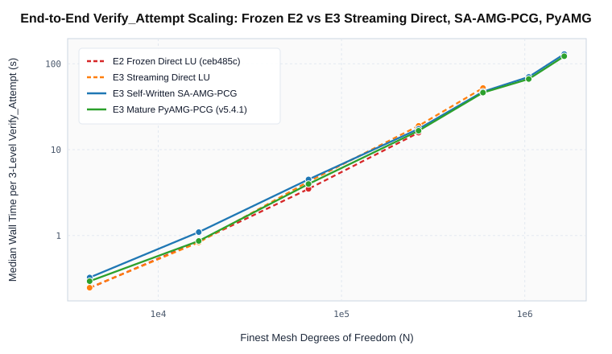
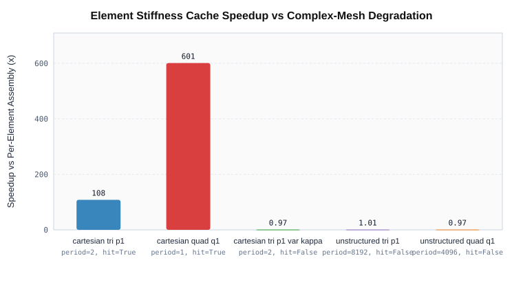
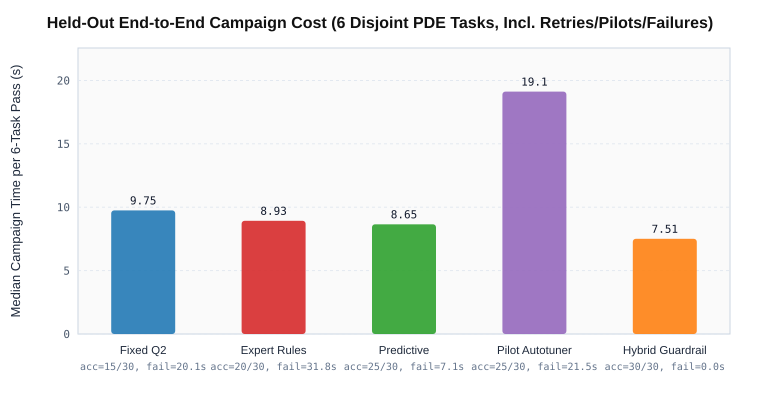
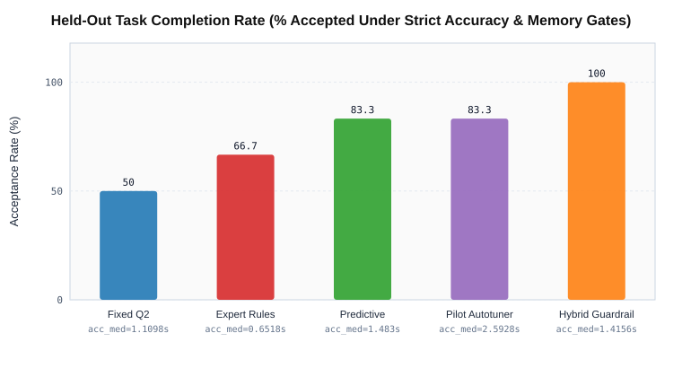

# E3.1 Performance Scalability, Unstructured/AMR Verification & Risk-Aware Adaptive Decision

- **Branch**: `research/e3-scaling-adaptive` (HEAD `07dca409`)
- **Frozen E2 Baseline**: `ceb485cb9836c73ce846f62d49ca9591fcb83bfc` (`/home/fy/project1-e2-ceb485c`)
- **Shared MFEM Binary**: `poisson_mms` SHA-256 `ac29f8a4c7963a9f...`
- **Resource Bounds**: `RLIMIT_AS=4096 MiB`, `timeout=260.0 s`, single-thread affinity, `5` randomized paired blocks
- **Third-Party Reference Baseline**: `pyamg==5.4.1` in isolated `/home/fy/.venvs/e3-amg`
- **Strict Numerical Gates**: `self_report_rel_tol=1e-06`, `reference_solve_rel_tol=1e-07`, `dirichlet_nodal_abs_tol=1e-10`

## 1. Strict Paired Scalability (`verify_attempt`, 4k to 1.64M DOFs)

Source: [`evidence/e3/scaling_4k_to_1m.json`](../evidence/e3/scaling_4k_to_1m.json)

| Finest N | True DOFs | Method | Accepted/Blocks | Wall Median (s) | 95% CI (s) | Peak RSS (MiB) | CG Iters | Rel Residual | Backward Err | Ref Rel Diff | Speedup vs E2 (Accepted Pairs) | Failure Reasons |
|---:|---:|---|---:|---:|---|---:|---:|---:|---:|---:|---|---|
| 64 | 4,225 | `e2_frozen_direct` | 5/5 | 0.2451 | [0.2215s, 0.2551s] | 91.3 | — | — | — | 1.04e-10 | — | — |
| 64 | 4,225 | `e3_streaming_direct` | 5/5 | 0.2470 | [0.2381s, 0.2601s] | 92.6 | 1 | 2.91e-14 | 1.15e-16 | 1.04e-10 | 0.962x [0.903x, 1.029x] | — |
| 64 | 4,225 | `e3_sa_amg_pcg` | 5/5 | 0.3247 | [0.3158s, 0.3482s] | 84.3 | 13 | 2.26e-14 | 8.93e-17 | 1.04e-10 | 0.746x [0.701x, 0.755x] | — |
| 64 | 4,225 | `e3_pyamg` | 5/5 | 0.2942 | [0.2850s, 0.3425s] | 98.5 | 11 | 2.23e-14 | 8.80e-17 | 1.04e-10 | 0.831x [0.647x, 0.876x] | — |
| 128 | 16,641 | `e2_frozen_direct` | 5/5 | 0.8579 | [0.8061s, 0.8754s] | 146.8 | — | — | — | 1.04e-10 | — | — |
| 128 | 16,641 | `e3_streaming_direct` | 5/5 | 0.8335 | [0.8234s, 0.8637s] | 148.3 | 1 | 1.02e-13 | 1.31e-16 | 1.04e-10 | 1.003x [0.975x, 1.042x] | — |
| 128 | 16,641 | `e3_sa_amg_pcg` | 5/5 | 1.0972 | [1.0782s, 1.1432s] | 98.5 | 12 | 7.05e-14 | 9.03e-17 | 1.04e-10 | 0.766x [0.735x, 0.797x] | — |
| 128 | 16,641 | `e3_pyamg` | 5/5 | 0.8660 | [0.8371s, 0.9500s] | 153.9 | 11 | 6.89e-14 | 8.83e-17 | 1.04e-10 | 0.931x [0.919x, 1.026x] | — |
| 256 | 66,049 | `e2_frozen_direct` | 5/5 | 3.4936 | [3.2522s, 3.5407s] | 388.2 | — | — | — | 1.04e-10 | — | — |
| 256 | 66,049 | `e3_streaming_direct` | 5/5 | 4.2529 | [4.1114s, 4.4326s] | 240.8 | 1 | 3.02e-13 | 1.30e-16 | 1.04e-10 | 0.810x [0.775x, 0.839x] | — |
| 256 | 66,049 | `e3_sa_amg_pcg` | 5/5 | 4.5062 | [4.3304s, 4.5667s] | 163.2 | 13 | 2.13e-13 | 9.15e-17 | 1.05e-10 | 0.775x [0.737x, 0.796x] | — |
| 256 | 66,049 | `e3_pyamg` | 5/5 | 3.9879 | [3.8927s, 4.0618s] | 158.9 | 11 | 2.02e-13 | 8.68e-17 | 1.05e-10 | 0.869x [0.835x, 0.881x] | — |
| 512 | 263,169 | `e2_frozen_direct` | 5/5 | 15.7779 | [15.3496s, 17.1630s] | 1424.0 | — | — | — | 1.05e-10 | — | — |
| 512 | 263,169 | `e3_streaming_direct` | 5/5 | 18.9626 | [18.1764s, 19.1977s] | 778.9 | 1 | 9.31e-13 | 1.38e-16 | 1.05e-10 | 0.822x [0.811x, 0.905x] | — |
| 512 | 263,169 | `e3_sa_amg_pcg` | 5/5 | 17.4433 | [17.1298s, 18.0773s] | 432.1 | 13 | 6.16e-13 | 9.12e-17 | 1.05e-10 | 0.892x [0.873x, 0.984x] | — |
| 512 | 263,169 | `e3_pyamg` | 5/5 | 16.6024 | [16.1465s, 17.1079s] | 355.1 | 15 | 6.49e-13 | 9.61e-17 | 1.05e-10 | 0.960x [0.922x, 1.026x] | — |
| 768 | 591,361 | `e2_frozen_direct` | 0/5 | FAIL | — | OOM/FAIL | — | — | — | — | — | RLIMIT_AS 4096 MiB exceeded (exit=2) |
| 768 | 591,361 | `e3_streaming_direct` | 5/5 | 52.2110 | [49.1663s, 53.1435s] | 1866.8 | 1 | 1.74e-12 | 1.39e-16 | 1.03e-10 | — | — |
| 768 | 591,361 | `e3_sa_amg_pcg` | 5/5 | 47.4248 | [46.4182s, 48.4953s] | 959.5 | 13 | 1.15e-12 | 9.15e-17 | 1.03e-10 | — | — |
| 768 | 591,361 | `e3_pyamg` | 5/5 | 46.1521 | [44.9672s, 47.6319s] | 779.9 | 15 | 1.20e-12 | 9.55e-17 | 1.03e-10 | — | — |
| 1024 | 1,050,625 | `e2_frozen_direct` | 0/5 | FAIL | — | OOM/FAIL | — | — | — | — | — | RLIMIT_AS 4096 MiB exceeded (exit=2) |
| 1024 | 1,050,625 | `e3_streaming_direct` | 0/5 | FAIL | — | OOM/FAIL | — | — | — | — | — | SuperLU C malloc failed under RLIMIT_AS=4096 MiB; SuperLU spsolve OOM (gssv allocation failed under RLIMIT_AS) |
| 1024 | 1,050,625 | `e3_sa_amg_pcg` | 5/5 | 70.3043 | [66.0898s, 70.5261s] | 1507.5 | 13 | 1.77e-12 | 9.12e-17 | 1.06e-10 | — | — |
| 1024 | 1,050,625 | `e3_pyamg` | 5/5 | 66.4139 | [63.7013s, 72.1854s] | 1182.2 | 15 | 1.84e-12 | 9.50e-17 | 1.06e-10 | — | — |
| 1280 | 1,640,961 | `e2_frozen_direct` | 0/5 | FAIL | — | OOM/FAIL | — | — | — | — | — | RLIMIT_AS 4096 MiB exceeded (exit=2) |
| 1280 | 1,640,961 | `e3_streaming_direct` | 0/5 | FAIL | — | OOM/FAIL | — | — | — | — | — | SuperLU C malloc failed under RLIMIT_AS=4096 MiB |
| 1280 | 1,640,961 | `e3_sa_amg_pcg` | 5/5 | 129.6653 | [127.9852s, 130.4696s] | 2483.3 | 13 | 2.48e-12 | 9.13e-17 | 1.03e-10 | — | — |
| 1280 | 1,640,961 | `e3_pyamg` | 5/5 | 122.2629 | [119.8640s, 122.5694s] | 1833.8 | 14 | 2.50e-12 | 9.19e-17 | 1.03e-10 | — | — |




### 1.1 Real Frozen E2 (`ceb485c`) vs E3 End-to-End `controller.run_study` Paired Comparison

| Mesh Levels | Finest DOFs | E2 Accepted | E3 Accepted | E2 Wall Median (s) | E3 Wall Median (s) | E2 Peak RSS (MiB) | E3 Peak RSS (MiB) | Paired Speedup Median [95% CI] |
|---|---:|---:|---:|---:|---:|---:|---:|---|
| `[64, 128, 256]` | 66,049 | 5/5 | 5/5 | 5.221 | 6.064 | 394.7 | 239.2 | 0.861x [0.846x, 0.951x] |
| `[128, 256, 512]` | 263,169 | 5/5 | 5/5 | 24.834 | 28.282 | 1430.6 | 772.9 | 0.869x [0.854x, 0.890x] |

## 2. Unstructured Gmsh, High-Order P1–P4/Q1–Q4 & Independent AMR Verification

Source: [`evidence/e3/complex_meshes_and_amr.json`](../evidence/e3/complex_meshes_and_amr.json)

| Geom | Order | All Verified | Observed L2 Order | Observed H1-Semi Order | Finest Ref Rel Diff |
|---|---:|---|---:|---:|---:|
| `tri` | 1 | True | 1.974 | 0.990 | 1.04e-10 |
| `tri` | 2 | True | 2.994 | 1.977 | 1.04e-10 |
| `tri` | 3 | True | 4.032 | 2.986 | 1.04e-10 |
| `tri` | 4 | True | 4.972 | 3.963 | 1.04e-10 |
| `quad` | 1 | True | 1.997 | 0.999 | 1.04e-10 |
| `quad` | 2 | True | 2.995 | 2.000 | 1.05e-10 |
| `quad` | 3 | True | 3.960 | 2.967 | 1.04e-10 |
| `quad` | 4 | True | 5.010 | 4.015 | 1.05e-10 |

| Case | Mesh/Order | Steps | Final True DOFs | Max Hanging Cont. Err | Final H1-Semi Err | Final Ref Rel Diff | Verdict |
|---|---|---:|---:|---:|---:|---:|---|
| `steep_amr_quad_q1` | `quad` Q1 | 8 | 131 | 3.47e-18 | 4.373e-01 | 2.62e-11 | `ACCEPTED` |
| `steep_amr_quad_q2` | `quad` Q2 | 7 | 557 | 0.00e+00 | 4.429e-02 | 1.01e-14 | `ACCEPTED` |
| `steep_amr_tri_p2` | `tri` Q2 | 6 | 1,145 | 0.00e+00 | 3.448e-02 | 2.30e-13 | `ACCEPTED` |
| `steep_uniform_quad_q1` | `quad` Q1 | 5 | 16,641 | 0 | 7.581e-02 | — | `REJECTED` |
| `steep_uniform_quad_q2` | `quad` Q2 | 5 | 16,641 | 0 | 7.476e-03 | — | `REJECTED` |
| `lshape_amr_q1` | `quad` Q1 | 9 | 91 | 0.00e+00 | 6.352e-02 | 2.34e-15 | `ACCEPTED` |
| `lshape_amr_q2` | `quad` Q2 | 8 | 233 | 0.00e+00 | 9.286e-03 | 5.87e-15 | `ACCEPTED` |
| `lshape_uniform_q1` | `quad` Q1 | 6 | 30 | 0 | 1.006e-01 | — | `ACCEPTED` |
| `lshape_uniform_q2` | `quad` Q2 | 5 | 93 | 0 | 6.029e-02 | — | `ACCEPTED` |

| Period Cache Scenario | Elements | Detected Period | Cache Hit | Scan (s) | Cache Assembly (s) | No-Cache Assembly (s) | Speedup |
|---|---:|---:|---|---:|---:|---:|---:|
| `cartesian_tri_p1_const` | 32,768 | 2 | True | 0.00073 | 0.00047 | 0.05045 | 108.11x |
| `cartesian_quad_q1_const` | 16,384 | 1 | True | 0.00049 | 0.00062 | 0.37334 | 601.07x |
| `cartesian_tri_p1_var_kappa` | 32,768 | 2 | False | 0.00077 | 0.05308 | 0.05161 | 0.97x |
| `unstructured_tri_p1_const` | 8,192 | 8,192 | False | 0.00021 | 0.02419 | 0.02438 | 1.01x |
| `unstructured_quad_q1_const` | 4,096 | 4,096 | False | 0.00014 | 0.11242 | 0.10864 | 0.97x |




## 3. Separated Risk-Aware Adaptive Decision Evaluation

- **Calibration Tasks (6 disjoint IDs)**: `['sin_sin', 'cos_exp', 'sin_2x_2y', 'sin_sin_variable', 'gaussian_mid', 'sin_cos']` (46 observations, L2 log10 RMSE=`0.3291`)
- **Held-Out Tasks (6 unseen IDs × 5 repeats = 30 runs/strategy)**: `['sin_3x_2y', 'cos_2x_sin_y_var', 'gaussian_sharp', 'gaussian_steep', 'lshape_singularity', 'sin_2x_3y']`

| Strategy | Accepted/Total | Completion Rate | Accepted Wall Median [95% CI] | Failed Cost Sum (s) | Retries | Solver (s) | Verifier (s) | Decision+Pilot (s) | Max RSS (MiB) | Accepted Speedup vs Fixed (Pairs) | Accepted Speedup vs Pilot (Pairs) |
|---|---:|---:|---|---:|---:|---:|---:|---:|---:|---|---|
| `fixed_baseline` | 15/30 | 50.0% | 1.110 [1.068s, 3.576s] | 20.07 | 20 | 9.18 | 39.50 | 0.04 | 300.4 | 1.000x [1.000x, 1.000x] (n=15) | 2.290x [1.591x, 2.394x] (n=15) |
| `expert_rules` | 20/30 | 66.7% | 0.652 [0.528s, 0.785s] | 31.77 | 20 | 3.85 | 40.59 | 0.04 | 123.6 | 2.429x [1.384x, 6.693x] (n=15) | 4.552x [3.515x, 5.677x] (n=20) |
| `predictive_model` | 25/30 | 83.3% | 1.483 [0.462s, 2.025s] | 7.10 | 15 | 4.75 | 38.64 | 0.05 | 264.6 | 2.370x [1.296x, 2.402x] (n=15) | 3.701x [1.869x, 5.600x] (n=20) |
| `pilot_autotuner` | 25/30 | 83.3% | 2.593 [2.518s, 2.874s] | 21.47 | 20 | 4.88 | 32.90 | 58.12 | 300.4 | 0.437x [0.407x, 0.629x] (n=15) | 1.000x [1.000x, 1.000x] (n=25) |
| `hybrid_guardrail_predictor` | 30/30 | 100.0% | 1.416 [0.907s, 1.555s] | 0.00 | 5 | 3.39 | 33.86 | 0.05 | 181.2 | 2.435x [0.660x, 2.664x] (n=15) | 2.559x [1.607x, 4.297x] (n=25) |




## 4. Reproducibility Commands

```bash
git clone --branch research/e3-scaling-adaptive https://github.com/hurry211/project1.git
cd project1
./scripts/build_mfem.sh && ./scripts/build_solver.sh
pytest -q --require-mfem
python -m benchmarks.e3_scaling --scales 64 128 256 512 768 1024 1280 --blocks 5
python -m benchmarks.e3_complex_meshes
python -m benchmarks.e3_adaptive --repeats 5
python -m benchmarks.e3_generate_artifacts --verify-consistency
```

## 5. CI & Historical Regression Ledger

Source: [`evidence/e3/ci_regression_summary.json`](../evidence/e3/ci_regression_summary.json)
- `pytest_full_non_mpi`: **PASSED** (`464 passed, 9 deselected in 118.41s (0:01:58)`)
- `cli_quickstart`: **PASSED** (`exit=0 (1.52s)`)
- `cli_stage4_plan`: **PASSED** (`exit=0 (1.48s)`)
- `stage2_coverage`: **PASSED** (`PASS sin_sin_variable_gmsh22_tri_2_full_cg_gs`)
- `stage1_robustness_284_plus_14_controls`: **PASSED** (`14 reference checker controls; saved /tmp/e31_ci_ju6hru97/robustness.json`)
- `e1_paired_compact`: **PASSED** (`H2_block000_gs OK 0.777s`)
- `e1_offline_audit`: **PASSED** (`exit=0`)
- `verified_revision_compact`: **PASSED** (`C1 1 baseline OK 0.746`)
- `verified_revision_offline_audit`: **PASSED** (`exit=0`)
- `performance_mixed_repeats2`: **PASSED** (`{"passed": true, "report": "/tmp/e31_ci_ju6hru97/perf/performance.json"}`)
- `mpi_integration_suite`: **BLOCKED** (`Blocked cleanly in local WSL2: system packages openmpi-bin, libopenmpi3t64, libhypre-2.28.0, libmetis5 not installed (sudo apt-get required).`)
